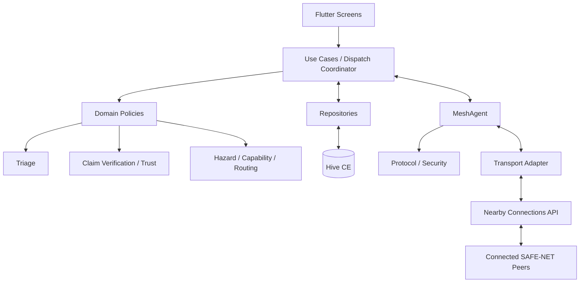

# SAFE-NET v1.0 — Architecture

**Purpose:** Explain how SAFE-NET components interact and how data flows.  
**Target:** Flutter, Android-first, offline-first, peer-to-peer; no required cloud.  
**Related files:** `docs/PRD.md`, `docs/agent/BUILD_PROMPT.md`, `reference_product_brief.png`.

## 1. Architecture in one sentence

Each device stores its own SOS records and decisions locally; Riverpod coordinates app state, domain services evaluate requests, Hive CE persists state, and `MeshAgent` exchanges validated messages with connected peers through a transport adapter.

A successful local save, peer transmission, peer acknowledgement, responder acceptance, and physical arrival are **different states**. Never display one as another.

## 2. System diagram



Each peer runs its own instance. There is no central authority that can see all disconnected devices.

## 3. Component ownership

- **Presentation:** role selection, victim, responder and diagnostics screens. Displays provider state and submits user actions. No direct Hive writes or transport calls.
- **Use cases / DispatchCoordinator:** coordinates SOS submission, review, accept/reject, retry and reconciliation. Owns workflow ordering.
- **Domain policies:** pure-Dart triage, claim checks, local trust assessment, hazard checks, capability matching, battery policy and routing cost.
- **Repositories:** the normal application interface to Hive CE. Persist SOS records, nodes, events, inbox, outbox and settings.
- **Protocol/security:** versioned serialization, size/schema validation, authenticated encryption integration, sender-proof verification, replay protection and log redaction.
- **MeshAgent:** connected-peer tracking, bounded forwarding, acknowledgements, retries, deduplication and outbox scheduling.
- **Transport adapter:** wraps the installed nearby-connections package and reports actual peer/send events. Verify its API against the project's locked package version; do not assume it provides automatic multi-hop broadcast.
- **PowerAgent:** observes real battery state and applies a scanning/forwarding policy. Diagnostics overrides are separate from real readings.

Suggested structure (adapt to the existing repository without merging these responsibilities):

```text
lib/
  app/                 # bootstrap, routing, theme
  domain/              # models, agents, policies, use cases
  data/local/          # Hive setup and repositories
  data/protocol/       # envelope, validation, crypto integration
  data/mesh/           # MeshAgent, adapter, peer registry, outbox
  features/            # role, victim, responder, diagnostics, shared UI
  providers/            # Riverpod dependency/state providers
 test/                  # unit, protocol, repository, mesh, widget, integration
```

## 4. Startup flow

1. Initialize Flutter bindings and app-private storage.
2. Register generated Hive adapters before opening boxes.
3. Open boxes and verify schema compatibility.
4. Recover interrupted outbox work; load local settings and existing SOS records.
5. Construct repositories and services with Riverpod.
6. Read battery and permission status. Request permissions only when the relevant feature needs them.
7. Start discovery only when role, permission, power policy and user settings allow it.

If startup or a dependency fails, show an actionable error. Do not silently claim that mesh services are active.

## 5. Main data flows

### A. Victim submits SOS

1. Validate and length-limit text; capture location only with permission and label unavailable/stale location honestly.
2. `TriageAgent` returns a deterministic recommendation, possible needs, rule evidence and uncertainty. It is not a diagnosis.
3. Create a unique SOS ID and local creation event.
4. Persist the SOS and outbox item before attempting network delivery.
5. Show **Saved locally / Queued** until delivery evidence supports a stronger status.
6. `MeshAgent` encrypts and sends the versioned envelope to eligible connected peers. Record send attempts and acknowledgements separately.

### B. Peer receives a message

1. Enforce frame-size limits; decode and validate protocol/schema version.
2. Verify authentication and cryptographic protections according to the implemented protocol. Reject invalid or replayed envelopes.
3. Deduplicate by message ID and persist accepted input in the inbox.
4. Apply expiry and forwarding limits; forward only according to policy, without repeatedly forwarding the same item.
5. Run domain evaluation for local display/dispatch. A relay does not automatically become an authority on the victim's claims.

### C. Responder evaluates an SOS

```text
Protocol admission + deduplication
  -> Claim verification
  -> Hazard assessment
  -> Receiver-local trust assessment
  -> Triage / urgency policy
  -> Capability and battery/routing cost
  -> Human review
  -> Persist accept/reject event
  -> Propagate event when a peer is available
```

- Invalid protocol/authentication: reject from dispatch processing.
- Confirmed malicious or policy-blocked input: show the reason and preserve only the audit data allowed by retention policy.
- `LOW` urgency: do not automatically consume critical-medical capacity; retain and display according to triage policy. Unknown or ambiguous messages must not silently become safe.
- `CRITICAL`/`HIGH`: show the available evidence, need, location quality, battery and recommendation. A countdown is informational; timeout must never imply acceptance.
- Accept/reject is a human decision. `ACCEPTED` means acknowledged by a responder, not departed or arrived.

### D. Outbox, partition and reconnection

1. If there is no eligible peer, keep the durable outbox item queued.
2. On connection, retry pending items within limits and track per-peer delivery/acknowledgement.
3. Persist inbound events before marking them processed.
4. On reconnect, exchange needed IDs/events, deduplicate, validate revisions and reconcile state using a documented deterministic policy.
5. Preserve competing acceptance events as conflicts when necessary; do not hide them as “0 conflicts” unless the reconciliation result proves that.

A diagnostic `isPartitioned` flag simulates application-level disconnection only. Real connectivity is the observed set of local peers and link events.

**Distributed-systems limit:** two disconnected responders can independently accept one SOS. Reconciliation can detect and represent competing accepts, but it cannot undo physical actions already taken. Do not claim global exactly-once dispatch or guarantee a single accept across partitions.

## 6. Data and state rules

Keep the requested `Node` and `SOSMessage` Hive field IDs stable for V1 compatibility. Add protocol metadata, delivery state and dispatch event history in separate versioned records unless a migration is explicitly implemented and tested.

- Treat incoming `trustScore` and `isSpoofed` as untrusted claims, never as receiver decisions.
- Compute trust locally from evidence and store the assessment separately from the received message.
- Give unknown peers an explicit **unknown/unverified** state; a default numeric score is not evidence of trust.
- Use controlled enums/state transitions internally; serialize to strings only at persistence/wire boundaries when required.
- Use message IDs, expiry, forwarding limits and deduplication to bound repeated delivery.
- Keep event history sufficient to explain local state changes. Wall-clock timestamps from a peer are not trusted proof of ordering.
- Define retention/deletion rules for message text, location, identity metadata and diagnostics logs.

Recommended distinct concepts:

- **SOS status:** `SEARCHING`, `ACCEPTED`, `REJECTED`, `EXPIRED`, plus any separately specified operational states.
- **Delivery status:** `PENDING`, `SENT_TO_PEER`, `ACKNOWLEDGED`, `RETRYABLE_FAILURE`.
- **Verification status:** `UNKNOWN`, `VALID`, `INVALID`, `EXPIRED`, `REPLAYED`.

Do not collapse these into one `status` field.

## 7. Security and privacy requirements

- The payload field `"encryption":"E2E_AES_256"` is metadata, not encryption.
- Before claiming E2E security, define and implement vetted authenticated encryption, key establishment/distribution, nonce handling, key identity, signature/authentication requirements, rotation/revocation and failure behavior. Use a maintained cryptographic library and review its API against the locked version.
- A valid signature proves control of a key under the selected key model; it does not prove real-world identity, professional credentials, truthful content or GPS location.
- Do not place victim plaintext in relay-visible metadata unless required and documented. Minimize routing metadata and explain its leakage.
- Never log raw SOS text, keys or precise location by default. Protect local sensitive data and define data-retention rules.
- Diagnostics injections must be clearly marked **SIMULATION** and must not be mistaken for real-world evidence.

If a secure key bootstrap or essential protocol behavior is not implemented, report it as a release blocker. Do not substitute self-asserted JSON flags for security controls.

## 8. Power, permissions and UI

- Determine Android permissions from the actual transport APIs, target SDK and Android versions. Handle denial, revocation and radios being disabled.
- Low battery should reduce nonessential scanning/forwarding, not silently disable every way to receive an SOS. Make the policy configurable and test it on physical devices.
- The low-power simulation must not change the reported physical battery level.
- Follow the product UI contract: black background, white text, Roboto Mono, square corners, no gradients and restrained animation. Show clear labels for queued, delivered, accepted, unknown and simulated states.
- Keep the reference image's evaluation sequence, but make the application display the actual outcome of each stage rather than decorative labels alone.

## 9. Core models and service interfaces

Keep interfaces small and testable. Names are illustrative; adapt to the repository and installed APIs.

```dart
abstract interface class SosRepository {
  Future<void> save(SOSMessage message);
  Stream<List<SOSMessage>> watchAll();
  Future<SOSMessage?> getById(String id);
  Future<void> recordDispatchEvent(DispatchEvent event);
}

abstract interface class MeshTransport {
  Stream<PeerEvent> get peerEvents;
  Stream<ReceivedFrame> get receivedFrames;
  Future<SendResult> sendToPeer(String peerId, List<int> frame);
  Future<void> start();
  Future<void> stop();
}
```

These are architectural interfaces, not claims about the installed package's exact API. Implement an adapter only after inspecting its locked version and real examples. Use fake implementations for deterministic unit tests.

## 10. Required tests and release gates

1. **Unit:** triage rules, input bounds, ambiguous/unknown cases, trust policy, status transitions and routing policy.
2. **Persistence:** Hive adapters, write/read, restart recovery, schema migrations and outbox crash recovery.
3. **Protocol:** malformed/oversized frames, bad authentication, replay, duplicate messages, expired messages and key failures.
4. **Mesh:** peer disconnects, retry limits, duplicate forwarding, acknowledgements and app restart.
5. **Partition:** two independent accepts, stale events, duplicated events and deterministic conflict reporting.
6. **Power/permissions:** low battery, denied/revoked permissions, disabled radios and background/resume behavior.
7. **Widget/integration:** victim submission, responder evaluation order, no auto-accept on timeout, diagnostics isolation and honest delivery status.
8. **Physical devices:** verify discovery and data exchange on supported Android devices. Emulator success alone is insufficient evidence for radio behavior.

Do not call the app production-ready until builds, automated tests, device tests, cryptographic/key-management review, privacy review and operational safety review have evidence. Report every untested feature and release blocker.

## 11. Implementation order

1. Inspect repo, SDKs, lockfile and transport package API.
2. Implement Hive models/repositories, typed state transitions and triage tests.
3. Implement screens and local-only workflows with explicit simulation labels.
4. Implement protocol envelope, validation and reviewed security/key design.
5. Implement transport adapter, durable inbox/outbox, acknowledgements and bounded forwarding.
6. Implement trust/capability/hazard evaluation, dispatch events and partition reconciliation.
7. Integrate power policy and permissions; run automated and physical-device tests.
8. Produce a verification report: commands run, pass/fail results, screenshots, device coverage, unresolved risks and release decision.

## 12. Non-negotiable engineering rules

- Inspect the repository before changing files; reuse existing conventions where sound.
- Do not invent package APIs or claim a build/test passed without running it.
- Do not trust sender-supplied trust scores, spoof flags, roles, timestamps or GPS as authoritative evidence.
- Do not claim reliable citywide delivery, guaranteed semantic triage, global exactly-once dispatch, or verified identity without evidence and a defined mechanism.
- No visible action may be a no-op or falsely report success.
- If a requirement cannot be safely implemented with the available stack, document the limitation and block release rather than hiding it behind UI.
